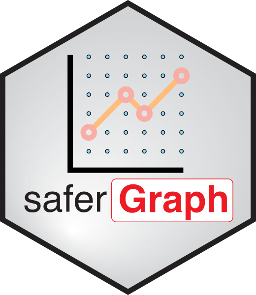

# saferGraph <a href="https://safer-r.github.io/saferGraph">[](https://safer-r.github.io/saferGraph/)</a>

<br />

<!-- badges: start -->

[](https://cran.r-project.org/package=saferGraph)
[](https://cran.r-project.org/)
[](https://r-pkg.org/pkg/saferGraph)<br />
[](https://github.com/safer-r/saferGraph/actions/workflows/rworkflows.yml)
[](https://app.codecov.io/github/safer-r/saferGraph?branch=master)
[](https://github.com/safer-r/.github/blob/main/profile/backbone.R)<br />
[](https://opensource.org/license/gpl-3.0)
<!-- badges: end -->

<br />

## Table of content

   - [Description](#description)
   - [Content](#content)
   - [Versions](#versions)
   - [Installation](#installation)
   - [Licence](#licence)
   - [Citations](#citations)
   - [Credits](#credits)
   - [acknowledgments](#acknowledgments)

<br />


## Description

Set of R functions for classical graphic handling, written according to the [safer-R project](https://github.com/safer-r) specifications.

<br />

## Content
<br />

Read this [webpage](https://safer-r.github.io/saferGraph) for more details.

<br />

| Function | Description |
| :--- | :--- |
| **close2()** | Close only specific graphic windows (devices). |
| **inter_ticks()** | Define coordinates and values of secondary ticks. |
| **open2()** | Open a pdf or screen (GUI) graphic window and return initial graphic parameters. |
| **post_plot()** | Redesign axis. If x_side = 0, y_side = 0, the function just adds text at topright of the graph and reset par() for next graphics and provides outputs. Provide also positions for legend or additional text on the graph. |
| **scale2()** | Attempt to select nice scale numbers when setting n ticks on a lim axis range. |

<br />

## Versions

The different *saferGraph* releases are tagged [here](https://github.com/safer-r/saferGraph/tags).

<br />

## Installation

```r
install.packages("saferGraph")
```

Older versions can be installed like this:

```r
v <- "v1.0" # desired tag version
remotes::install_github(paste0("https://github.com/safer-r/saferGraph", "/tree/", v))
```

<br />

## Licence

This package can be redistributed and/or modified under the terms of the GNU General Public License as published by the Free Software Foundation, either version 3 of the License, or (at your option) any later version.
Distributed in the hope that it will be useful, but without any warranty; without even the implied warranty of merchantability or fitness for a particular purpose.
See the GNU General Public License for more details at https://www.gnu.org/licenses or in the Licence.txt attached file.

<br />

## Citation

If you are using functions of *saferGraph*, please cite: 

> Wang H, Han Y, Legras M, Millot GA (2026). _The R saferGraph package_.
> <https://github.com/safer-r/saferGraph/>.

<br />

## Credits

[Haiding Wang](https://github.com/Tintin2710), Bioinformatics and Biostatistics Hub, Institut Pasteur, Paris, France

[Yushi Han](https://github.com/yushiHn), Bioinformatics and Biostatistics Hub, Institut Pasteur, Paris, France

[Mia Legras](https://github.com/mialgrs), Bioinformatics and Biostatistics Hub, Institut Pasteur, Paris, France

[Gael A. Millot](https://github.com/gael-millot), Bioinformatics and Biostatistics Hub, Institut Pasteur, Paris, France

<br />

## Acknowledgments

The developers & maintainers of the mentioned softwares and packages, including:

- [R](https://www.r-project.org/)
- [Git](https://git-scm.com/)
- [GitHub](https://github.com/)
- [rworkflows](https://github.com/neurogenomics/rworkflows)

